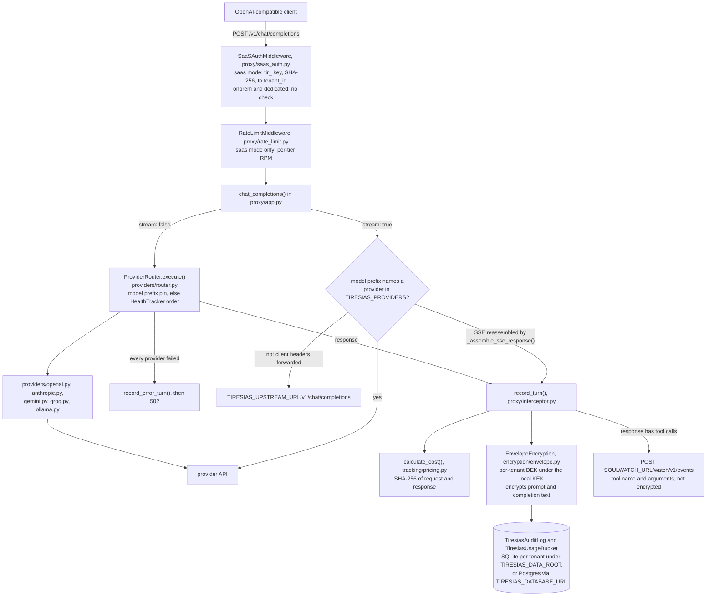
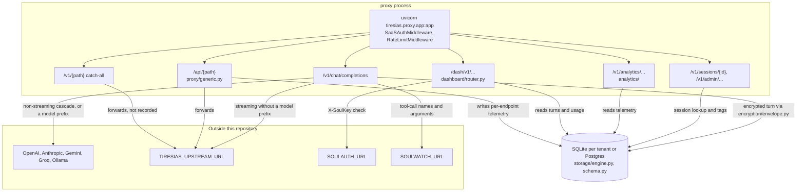

# tiresias-core

The source-available core of Tiresias: a self-hosted, OpenAI-compatible LLM proxy in Python that routes across providers, encrypts what it logs, tracks tokens and cost per session, and checks requests against YAML policies, with a dashboard API over the stored data.

## How it works

The main data path is `POST /v1/chat/completions` in `src/tiresias/proxy/app.py`. Traced on `origin/main` at 3c634b6; a pending security branch may change parts of it.



What the diagram makes visible: the prompt and completion are encrypted before storage, but token counts, cost, model, provider and the two hashes are stored in the clear, and tool-call names and arguments are sent unencrypted to `SOULWATCH_URL` (default `http://soulwatch-mssp:8001`, a service not in this repository) with a synchronous 2-second-timeout `httpx.post`; a failure is logged and ignored.

## Status

Source-available core, version 1.0.0 in `pyproject.toml`. Not published to PyPI. What is verified in this repository on 2026-10-22: the test suite passes (295 passed, 40 known failures marked `xfail`, see `tests/known_failures.txt`), and the proxy starts from a source install and answers `/health` (see Quickstart).

What does not work as previously documented: `docker compose up -d` fails, and the steps in `QUICKSTART.md` do not produce a running stack. See the correction below.

> **Correction, 2026-10-22.** Earlier versions of this README described the wider Tiresias platform as if it were in this repository, and gave a quickstart that does not run. Checked against `origin/main` at 3c634b6:
>
> - **Quickstart.** `docker compose up -d` fails before starting anything: `docker-compose.yml` builds a `relay` service from `Dockerfile.relay`, which is not in the repository. Started without the relay, the proxy container exits because the compose file passes `ENCRYPTION_KEY`, while the code reads `TIRESIAS_KEK`; the dashboard container exits because its command loads `tiresias.dashboard.app:app`, and that module only defines the factory `create_dashboard_app`. The `.env.example` names (`TIRESIAS_LICENSE_TOKEN`, `ENCRYPTION_KEY`, `DATABASE_URL`) are not read by the code, and it has no `TIRESIAS_TENANT_ID` line although the README told you to set one. The dashboard API is served by the proxy under `/dash/v1/...`, not on port 3000.
> - **Soulkeys.** Described as "persistent cryptographic identity for AI agents, SHA-512, tenant-scoped, revocable". This repository has no soulkey issuance or SHA-512. The dashboard accepts an `X-SoulKey` header and asks an external SoulAuth service (`SOULAUTH_URL`) whether it is valid, or accepts an API key checked against its stored SHA-256 hash.
> - **Audit.** Described as "structured audit events for 15+ event types". `audit/logger.py` accepts four event types (`sop_check`, `sop_grant`, `sop_deny`, `sop_violation`). The per-request and per-response SHA-256 content hashes are real (`proxy/interceptor.py`).
> - **Policy engine.** "Capability tokens (JWT)" are not in this repository. The YAML policies, the policy decision point (`auth/pdp.py`) and an `evaluate-sop` router (`routers/auth.py`) are in the source, but the proxy never mounts that router and no request path calls the policy decision point (amended 2026-10-22, see the next bullet).
> - **Policy enforcement and `evaluate-sop` (added 2026-10-22, from a second pass over `origin/main` at 3c634b6).** The earlier README said a "Policy Engine (PDP/PEP)" with a "tool policy engine" controls what agents can invoke, and an earlier draft of this correction listed `POST /v1/auth/evaluate-sop` as a proxy route. Neither is true of the running proxy: `create_app()` includes only the dashboard router, so `/v1/auth/evaluate-sop` is not a route (listed from `app.openapi()`); a POST to it falls through to the `/v1/{path}` catch-all and is forwarded to `TIRESIAS_UPSTREAM_URL`. `auth/rate_limiter.py` and `auth/spend_tracker.py` are imported by nothing. No request is checked against `policies/`.
> - **Streaming (added 2026-10-22).** An earlier draft said chat completions are "streaming or not, routed through the provider cascade". Only non-streaming requests use the cascade. A streaming request goes to the provider named by a model prefix (for example `ollama/llama3.1:8b`) when that provider is in `TIRESIAS_PROVIDERS`, and otherwise to `TIRESIAS_UPSTREAM_URL/v1/chat/completions` with the client's own headers, including its `Authorization`, so on that path the provider key must come from the client.
> - **Anomaly detection.** "18 detection types, behavioral baselines, real-time alerting, SIEM integration (Splunk, Elastic, Syslog, Sentinel)" are not in this repository.
> - **Comparison table.** The "Why Tiresias" table marked this core "Yes" for agent identity, CoT auditing and anomaly detection, which it does not have, and made claims about six other products that were not re-checked. It has been removed rather than corrected row by row; it remains in the git history.
> - **MASP section.** It said Tiresias gives "identity, audit, policy, detection, and cost attribution" dropped into any agent platform. Detection and identity issuance are not in this repository; the section is removed for the same reason.

## Install

Tested 2026-10-22 on Windows with Python 3.12 and uv 0.11; CI runs Python 3.11 and 3.12 on Ubuntu. `requires-python` is `>=3.11`.

```bash
git clone https://github.com/saluca-labs/tiresias-core.git
cd tiresias-core
uv sync --locked --extra dev
```

The container image builds (`docker compose build proxy`), but the compose stack does not start as shipped; see the correction above.

## Quickstart

Run the proxy from the source install. `TIRESIAS_KEK` is the local key-encryption key (any 64-hex value for a trial), `TIRESIAS_DATA_ROOT` is where per-tenant SQLite databases go (the default `/data` is usually not writable).

```bash
export TIRESIAS_KEK=$(python -c "import secrets; print(secrets.token_hex(32))")
export TIRESIAS_DATA_ROOT=./data
export TIRESIAS_TENANT_ID=demo
uv run uvicorn tiresias.proxy.app:app --port 8080
```

In another terminal, from a run on 2026-10-22:

```text
$ curl http://127.0.0.1:8080/health
{"status":"ok","service":"tiresias-proxy","mode":"onprem"}
```

To forward real requests, set at least one provider key before starting (`OPENAI_API_KEY`, `ANTHROPIC_API_KEY`, `GOOGLE_API_KEY`, `GROQ_API_KEY`) and list providers in `TIRESIAS_PROVIDERS` (default `openai`). With no key set, `POST /v1/chat/completions` returns `502 {"detail":"All providers exhausted. ..."}`, which is what the run above returned. A provider round trip was not run for this README.

## Usage

Point an OpenAI-compatible client at the proxy:

```python
from openai import OpenAI
client = OpenAI(base_url="http://localhost:8080/v1", api_key="any-value")  # provider keys come from the proxy's env
response = client.chat.completions.create(
    model="gpt-4o-mini",
    messages=[{"role": "user", "content": "Hello from Tiresias!"}],
)
```

Every route the proxy serves (`src/tiresias/proxy/app.py`, listed with `app.openapi()` on 2026-10-22, plus FastAPI's `/docs`, `/redoc` and `/openapi.json`). There are no others:

| Route | What it does |
|---|---|
| `GET /health` | Liveness and mode |
| `POST /v1/chat/completions` | OpenAI-compatible chat. Non-streaming requests go through the provider cascade; streaming requests do not (see How it works) |
| `POST /v1/sessions/{id}/tag`, `GET /v1/sessions/{id}` | Session tagging and lookup; send `x-tiresias-session-id` on requests |
| `GET /v1/admin/providers`, `POST /v1/admin/reload` | Provider cascade status and reload |
| `GET /dash/health` | Dashboard liveness, no auth |
| `GET /dash/v1/spend`, `/requests`, `/latency`, `/errors`, `/sessions/top`, `/sessions/{id}/replay`, `/traces`, `/providers/health` | Dashboard API over the stored data; needs `X-SoulKey` or a Tiresias API key |
| `/api/{path}` | Generic reverse proxy to `TIRESIAS_UPSTREAM_URL` with per-endpoint telemetry |
| `GET /v1/analytics/api/endpoints`, `/costs`, `/errors`, `GET /v1/analytics/unified` | Analytics over the generic proxy traffic |
| `/v1/{path}` (any other path under `/v1/`) | Catch-all: forwarded unchanged to `TIRESIAS_UPSTREAM_URL/v1/{path}`, not recorded |

### Authentication, as on `origin/main` (3c634b6)

A pending security branch may change this; the table describes `origin/main` only.

| Mode (`TIRESIAS_MODE`) | `/v1/...`, `/api/...`, `/v1/admin/...` | `/dash/v1/...` | Source |
|---|---|---|---|
| `onprem` (the default) or `dedicated` | no authentication; the tenant is `TIRESIAS_TENANT_ID` | `X-SoulKey` verified by `SOULAUTH_URL`, or a Tiresias API key whose SHA-256 matches the stored hash | `proxy/saas_auth.py`, `dashboard/auth.py` |
| `saas` | a `tir_` API key in `X-Tiresias-Api-Key` or `Authorization: Bearer`, SHA-256 looked up in `tiresias_licenses`, cached 60 s; `/health`, `/docs`, `/openapi.json`, `/redoc` exempt | the same dashboard check | `proxy/saas_auth.py` |

On first boot in `onprem` or `dedicated` mode, `bootstrap.first_boot()` generates the tenant API key, stores its SHA-256 and writes the key itself to the log once at INFO level. Run the proxy only where its port is reachable by clients you trust.

Configuration is environment variables, read by `src/tiresias/config.py` (`TiresiasSettings`). The ones most often needed: `TIRESIAS_MODE` (`onprem`, `dedicated`, `saas`), `TIRESIAS_TENANT_ID`, `TIRESIAS_KEK_PROVIDER` (only `local` works in core; the others raise "requires Tiresias Enterprise"), `TIRESIAS_KEK`, `TIRESIAS_DATA_ROOT`, `TIRESIAS_DATABASE_URL` (a `postgresql://` URL switches from per-tenant SQLite to one Postgres database), `TIRESIAS_PROVIDERS`, `TIRESIAS_RETENTION_DAYS`.

## Architecture

Process and trust boundaries of the running proxy:



In `src/` but not used by the running proxy: `routers/auth.py` (the `evaluate-sop` router, never mounted), which is the only caller of `auth/pdp.py`, `policy/loader.py`, `audit/logger.py` and the `policies/*.yaml` files; `auth/rate_limiter.py` and `auth/spend_tracker.py`, imported by nothing; and `dashboard/app.py`'s `create_dashboard_app()`, a standalone factory the proxy does not call (it mounts `dashboard/router.py` instead).


- `src/tiresias/proxy/`: the FastAPI app, request interception, rate limiting, generic API proxy, SaaS-mode API-key auth.
- `src/tiresias/providers/`: provider clients, the cascade router and health tracking.
- `src/tiresias/encryption/`: AEAD and envelope encryption; `providers/local.py` is the only KEK provider core enables.
- `src/tiresias/tracking/`: token counting, model pricing, sessions.
- `src/tiresias/auth/`, `src/tiresias/policy/`, `src/tiresias/routers/`, `policies/`: policy decision point, rate limiter, spend tracker, YAML policy loading and the `evaluate-sop` router. None of these is used by the proxy app (see the diagram); the rate limiting that runs is `proxy/rate_limit.py`.
- `src/tiresias/dashboard/`: dashboard router (mounted in the proxy), a standalone app factory and static UI files, and dashboard auth.
- `src/tiresias/storage/`: SQLAlchemy engine, schema, retention purge.

## Citation

No archived record yet.

## License

Functional Source License 1.1, Apache 2.0 Future License (FSL-1.1-Apache, SPDX `FSL-1.1-ALv2`), see [LICENSE](./LICENSE). Each release becomes available under the Apache License 2.0 two years after it ships. Copyright Saluca LLC.

GitHub shows the licence as "Other" because its licence detector does not include the FSL. Note that `NOTICE` and the `NOTICE` files in `src/tiresias/analytics/`, `providers/` and `proxy/` still say "Licensed under the Apache License, Version 2.0", left from before the 2026-08-18 relicence. `LICENSE` is authoritative.

### In this repo and not in this repo

| Module | License | Description |
|--------|---------|-------------|
| `tiresias-core` (this repository) | FSL-1.1-Apache | Proxy, provider routing, encryption, token and cost tracking, policy checks, dashboard API. |
| `tiresias-enterprise` | Commercial | BYOK key providers, Aletheia chain-of-thought auditing, air-gap licence relay, SIEM integration, MSSP and white-label. Not in this repository. |
| SoulAuth (`SOULAUTH_URL`) | not in this repository | The service the dashboard asks to validate an `X-SoulKey`. Without it, only API-key auth works on `/dash/v1/...`. |
| SoulWatch (`SOULWATCH_URL`) | not in this repository | The service that receives tool-call events from `record_turn()`. Unreachable is logged and ignored. |
| The hash-chained audit log | not in this repository | Tiresias platform; for an independent verifier of Saluca's chain format see [saluca-labs/chain-verify](https://github.com/saluca-labs/chain-verify). |

## Links

- [QUICKSTART.md](./QUICKSTART.md): the older Docker quickstart, with its own correction note
- [ROADMAP.md](./ROADMAP.md): planned work for the Tiresias product
- [SECURITY.md](./SECURITY.md): how to report a vulnerability
- [Zero Trust for AI Agents](https://www.saluca.com/p/zero-trust-for-ai-agents): why agents need their own security model
- [Your AI Agent Forgets Everything](https://www.saluca.com/p/your-ai-agent-forgets-everything): the case for persistent agent identity
- [We've Been Chasing the Wrong Intelligence](https://www.saluca.com/p/weve-been-chasing-the-wrong-intelligence): governance over capability
- Enterprise: [tiresias.network](https://tiresias.network); contact enterprise@saluca.com for enterprise licensing, BYOK, air-gap deployments and partner programs.
- [llms.txt](./llms.txt): a link map of this repo for AI agents

_Last updated: 2026-10-22_
